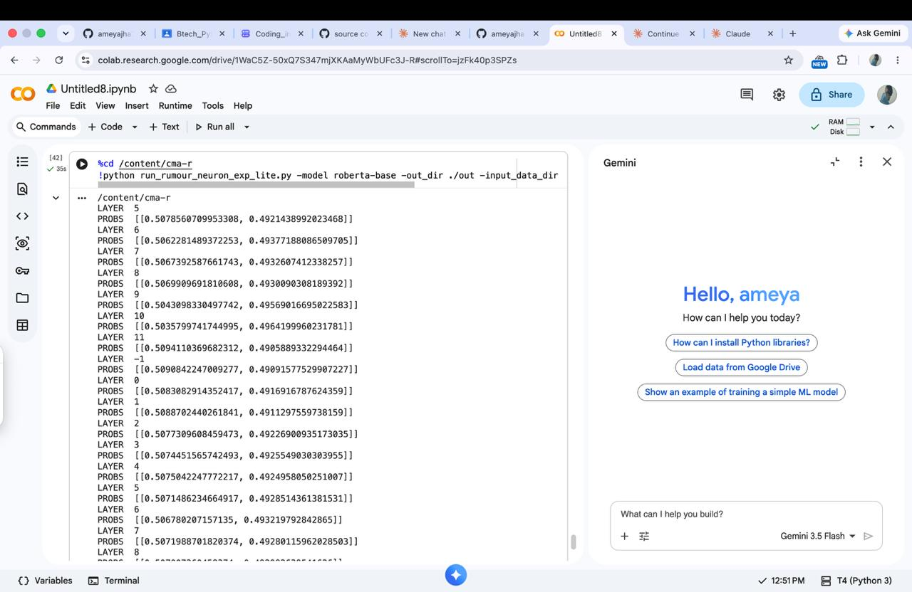
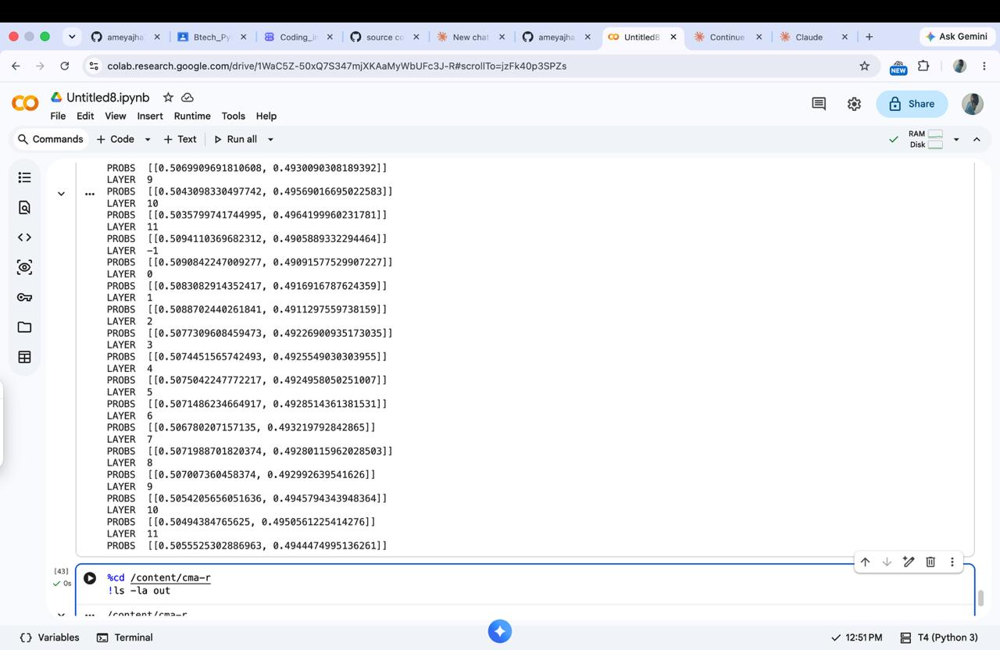
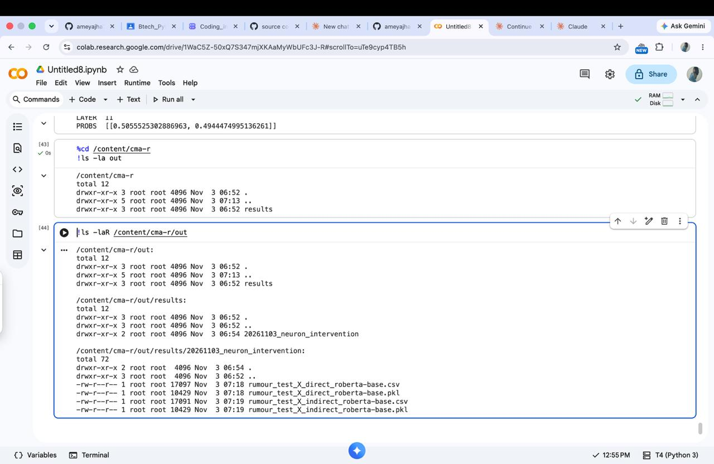
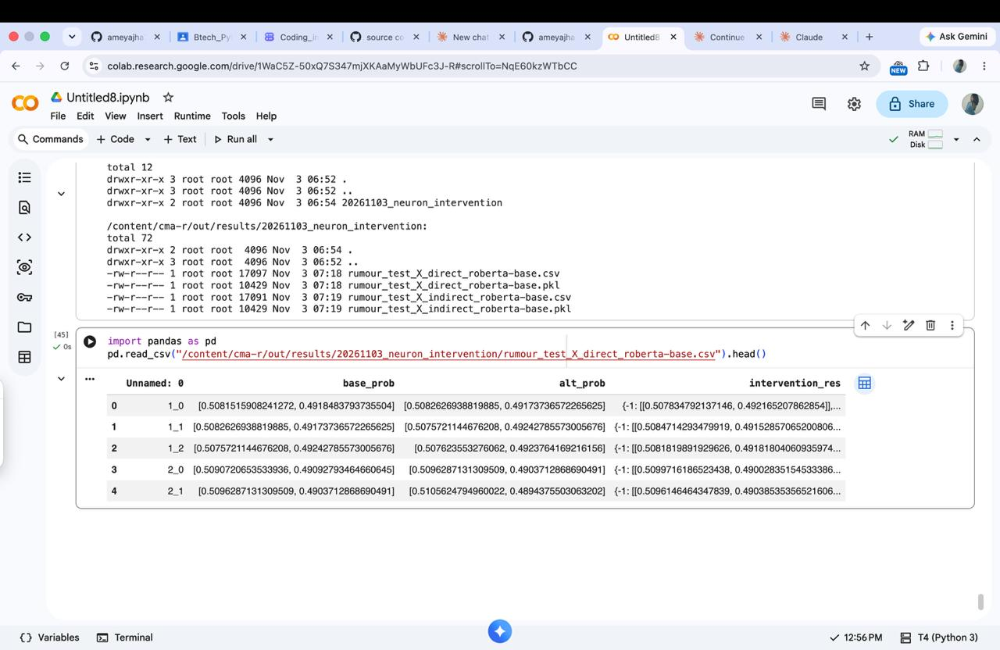

# CMA-R: Causal Mediation Analysis for Explaining Rumour Detection

### Here is the source code for our paper CMA-R, accepted by EACL 2024 findings.

We apply causal mediation analysis to explain the decision-making process of neural models for rumour detection on Twitter.
Interventions at the input and network level reveal the causal impacts of tweets and words in the model output.
We find that our approach CMA-R -- Causal Mediation Analysis for Rumour detection -- identifies salient tweets that explain model predictions and show strong agreement with human judgements for critical tweets determining the truthfulness of stories.
CMA-R can further highlight causally impactful words in the salient tweets, providing another layer of interpretability and transparency into these blackbox rumour detection systems.

## Execution in Google Colab (T4 GPU)

Command:
python run_rumour_neuron_exp_lite.py -model roberta-base -out_dir ./out -input_data_dir ./sample_data.pkl

### Fixes made
- Converted tabs to spaces; removed unused TransfoXLTokenizer import
- Fixed `alpha=1.,batch_size` syntax and the `tokennizer` typo
- Added compatibility shims for newer `transformers`
- Fixed `rumour_direct_intervention` to use `og_input_ids` / `og_attention_mask`

### Screenshots
**1. Running the experiment**

**2. Output across all layers**

**3. Saved result files**

**4. Results CSV preview**

Note: roberta-base was used without a fine-tuned rumour checkpoint, so probabilities are close to 0.5.
